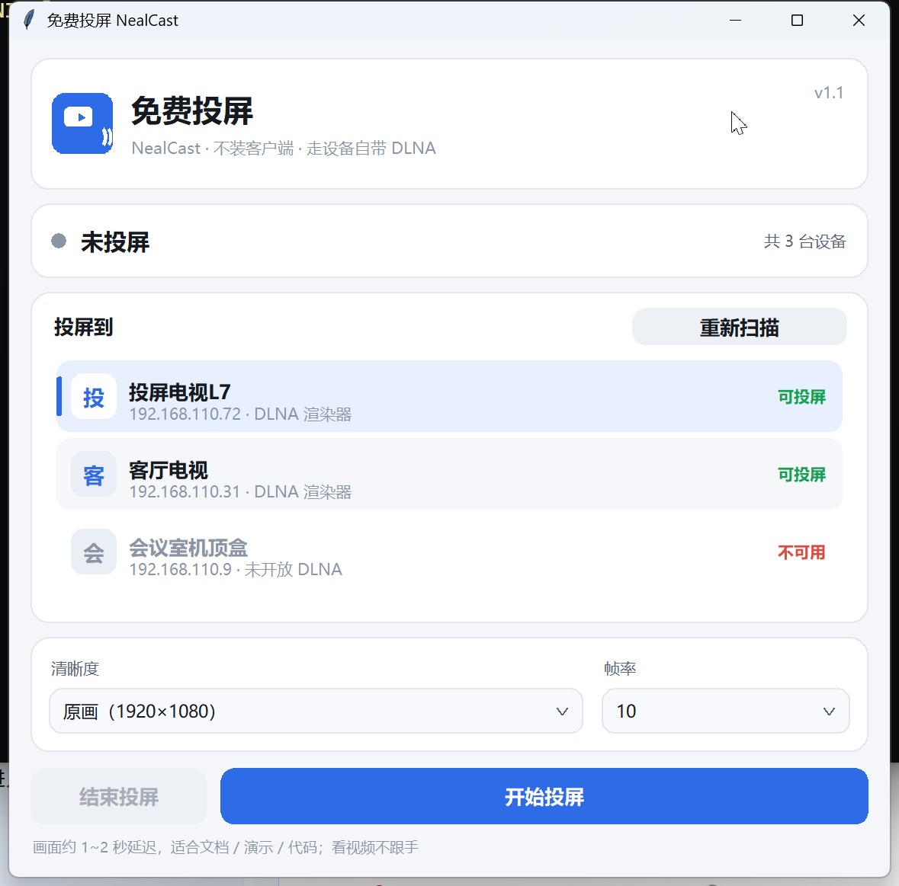

# 免费投屏 NealCast

<p align="center"></p>

把 Windows 电脑的屏幕，投到**任意支持标准 DLNA 的投影仪 / 电视 / 盒子**上。

- **不装客户端**：不在设备上装任何 APK，不依赖厂商私有协议
- **开源免费**：MIT 协议，代码全公开，个人商用都随便用
- **纯标准协议**：走 DLNA/UPnP（设备自带能力），装完即用
- **高分屏清晰**：按物理像素渲染，175% / 200% 缩放下文字不发虚

> 画面有 1~2 秒延迟，适合看文档、演示、代码；看视频不跟手。

<p align="center"></p>

## 安装（普通用户）

1. 下载 [`release/NealCast-Setup-1.1.0.exe`](./release/NealCast-Setup-1.1.0.exe)（或 [Releases](../../releases) 页）
2. 双击安装，一路下一步（装到用户目录，**不需要管理员权限**）
3. 打开「免费投屏」，选中你的投影仪/电视，点「开始投屏」

安装包已内置 ffmpeg，无需另外安装。投屏前把设备停在**投屏 / 等待接收**页面。

## 原理

多数 DLNA 渲染器只对 `image/*` 真正回源拉流，视频流（mp4/ts/HLS）会被「假接受」
（SOAP 返回 200 但设备一次都不来拉）。而**动画 GIF** 能让设备一次加载多帧连续播放，
把「每帧重建会话」的开销摊薄，帧率从 2fps 提升到 8~10fps。

```
抓屏(ffmpeg) → 短视频段 → GIF 量化分段 → 本地 HTTP 服务
                                      ↓
                  DLNA SetAVTransportURI + Play（标准 SOAP）
                                      ↓
                            设备来拉 → 循环播放这一段
    （同时生产下一段，无缝接力；画面静止时不推新段，零闪烁）
```

设备发现走三条通道并行：SSDP/UPnP 多播、mDNS、网段端口直连探测，约 3~6 秒出结果。
只列出**真正带 AVTransport 的渲染器**，端口开着的路由/打印机/摄像头不会混进来。

## 从源码运行

- Windows 10/11、Python 3.8+（带 tkinter）
- [ffmpeg](https://ffmpeg.org/) 放进 PATH，或直接丢一个 `ffmpeg.exe` 在本目录

```powershell
python cast_gui.py           # 打开面板
python gifcast.py 30         # 命令行投 30 秒
python discover.py           # 只做设备发现

# 打包成单文件 exe
pip install pyinstaller
python -m PyInstaller --onefile --windowed --name NealCast cast_gui.py
```

Python 依赖：**无**（只用标准库）。

## 已知限制

| 限制 | 原因 |
|---|---|
| 延迟 1~2 秒 | GIF 分段是「整段推完才播」，非实时流 |
| 帧率约 8~10fps | 设备端 GIF 是软解，分辨率越高帧率越低 |
| 左右可能有黑边 | 电脑屏幕 16:10、设备 16:9 时等比不变形的必然代价 |
| 看视频不跟手 | 同延迟限制；适合文档/演示/代码 |

设备侧前提：DLNA 渲染器必须**真的回源拉图片**。少数设备连图片都是假接受，那就投不了
（与本工具无关，是设备能力问题）。

## 常见问题

**面板找不到设备**
- 设备和电脑要在同一个局域网，且设备停在投屏等待页，点「重新扫描」
- **开着 Clash / VPN / 网络代理（尤其 TUN 模式）会把局域网流量劫持走**，扫描和投屏都会失败——请关掉，或给 `192.168.*` / `10.*` 等内网段配置直连规则
- 公司网络若隔离多播，网段直连探测可以兜底；被 ACL 拦住则无解

**开始投屏后黑屏**
多半是防火墙拦了设备来拉图（本机 8899 端口入站）。放行本程序的入站连接即可。

**停止投屏后设备没退回主页**
部分设备要 2~3 秒才切回，属正常。

## 免责声明

本项目仅通过公开标准协议（DLNA/UPnP）与设备做互操作，不包含任何厂商的代码、
商标或私有实现，与任何投影仪/电视品牌及其内置投屏软件无官方关联。
使用者应自行确保投屏内容的合法性，本项目不承担由此产生的任何责任。

## 许可证

[MIT](./LICENSE)。随便用，包括商用；保留版权声明即可。

安装包内附的 ffmpeg 是独立的第三方程序（GPL v3，随包装有其许可证文本），
其许可证由其自身决定，不约束本仓库代码；单独下载源码使用时，ffmpeg 由使用者自行安装。

## 更新日志

**1.1.0** — 界面重做：修复高分屏字体发虚（进程声明 Per-Monitor V2 DPI 感知 + 字号按物理像素渲染），
圆角卡片布局，自绘设备列表（图标 / 可投屏状态 / 悬停 / 双击投屏），自绘下拉框，
投屏中状态卡与主按钮自动切换。

**1.0.0** — 首个版本：GIF 分段投屏引擎、三通道设备发现、图形界面、Win11 免管理员安装包。
